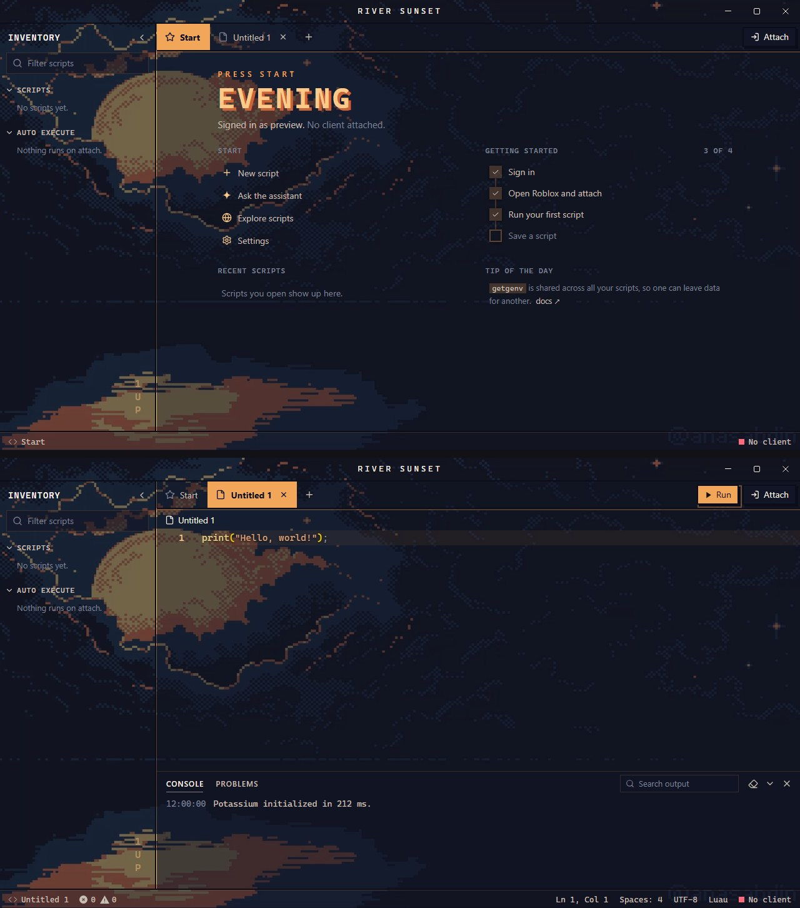
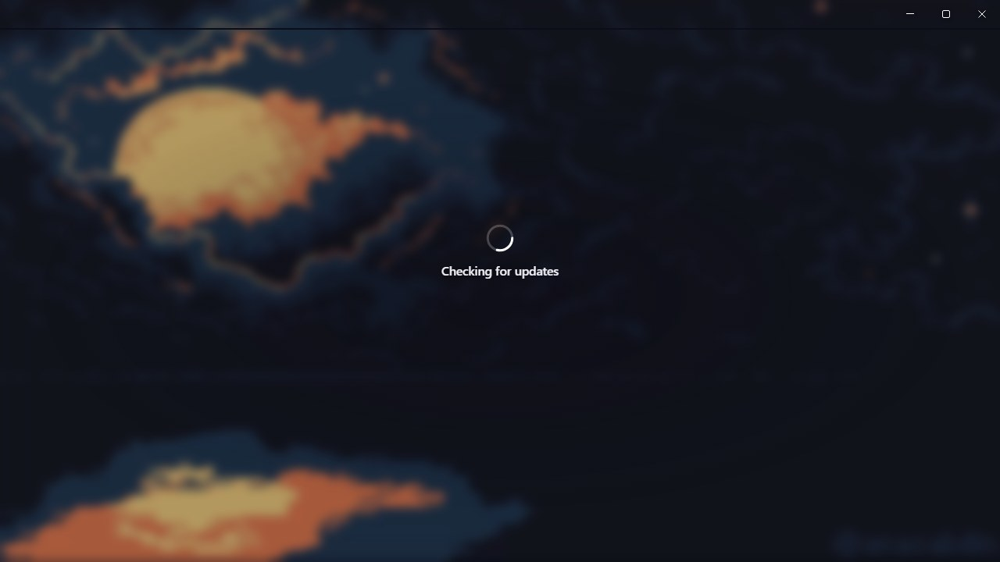
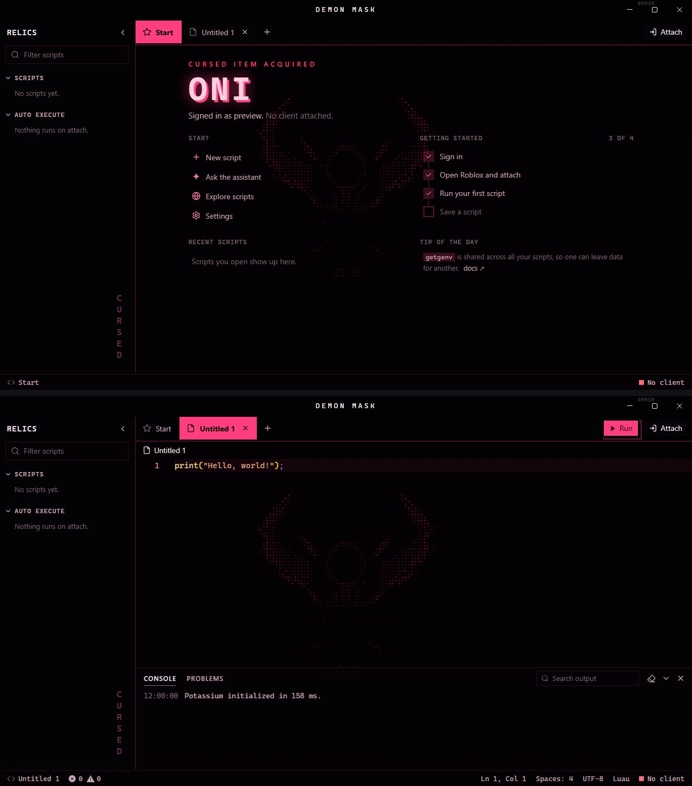
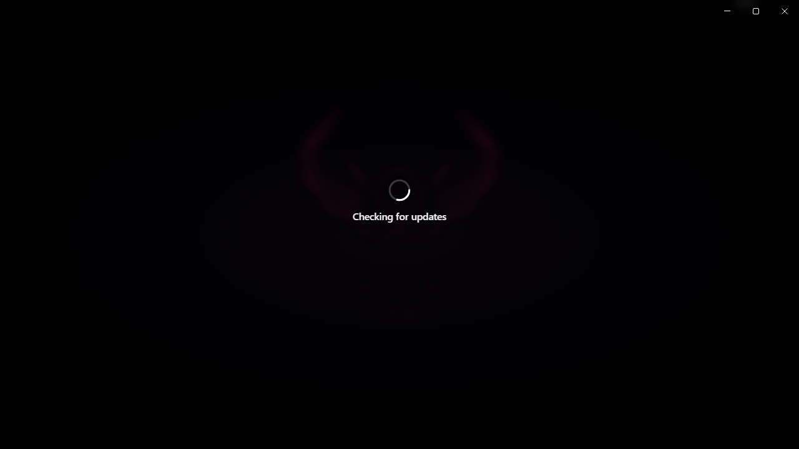
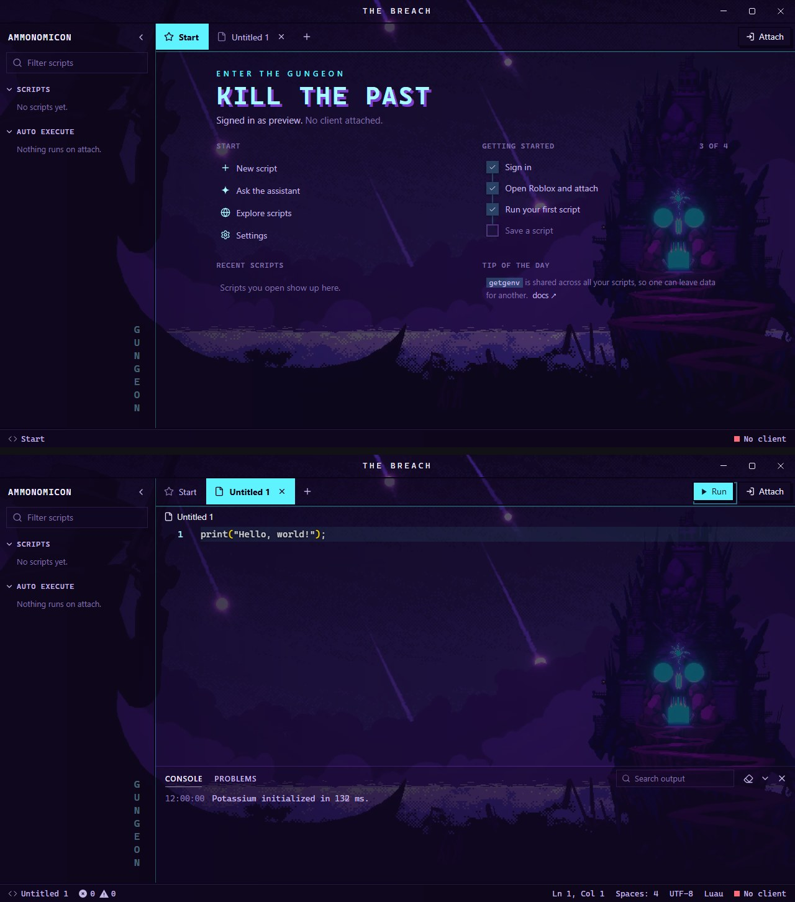
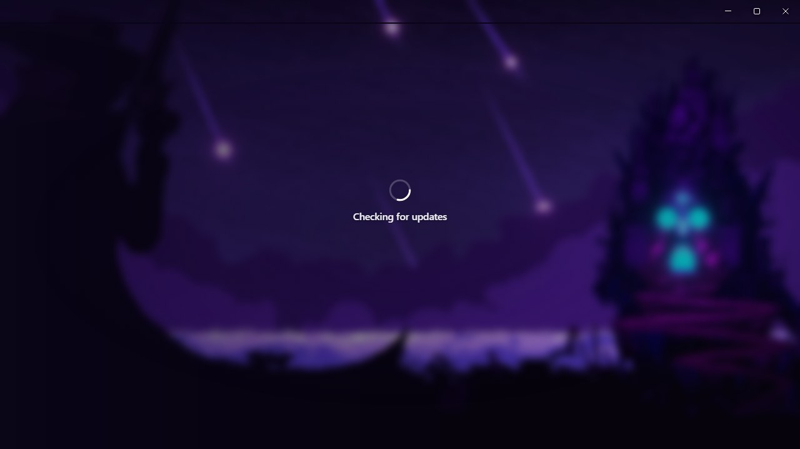
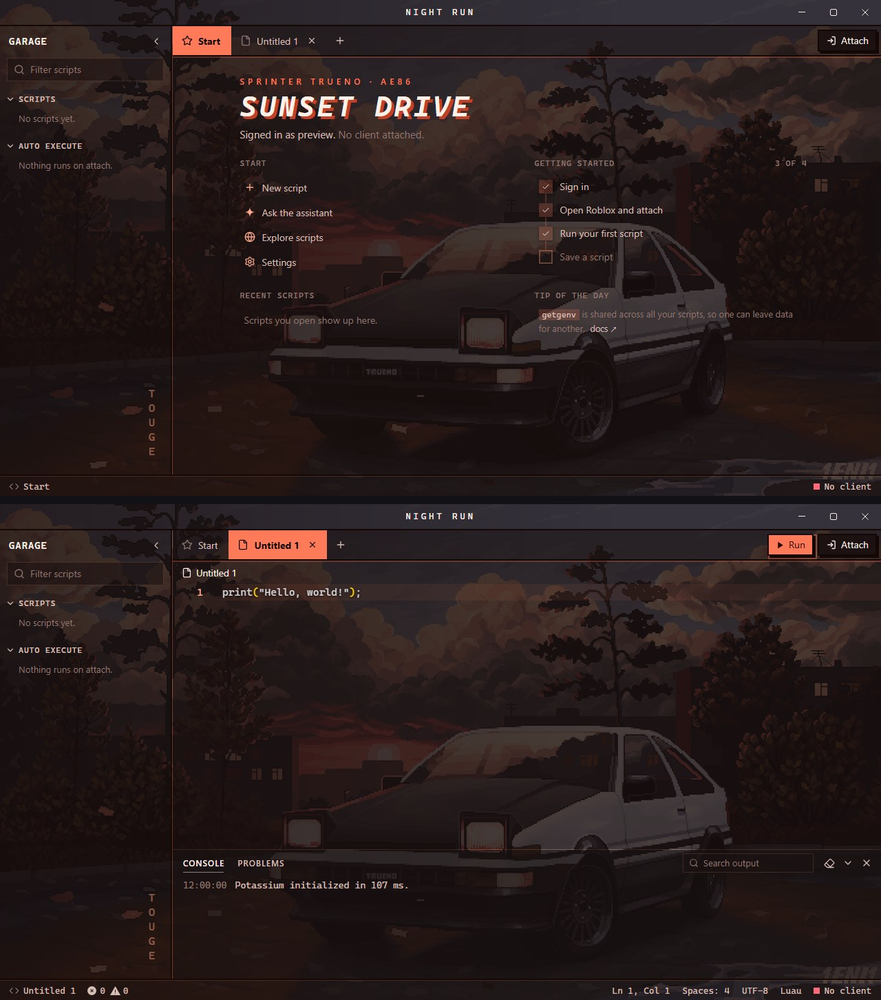
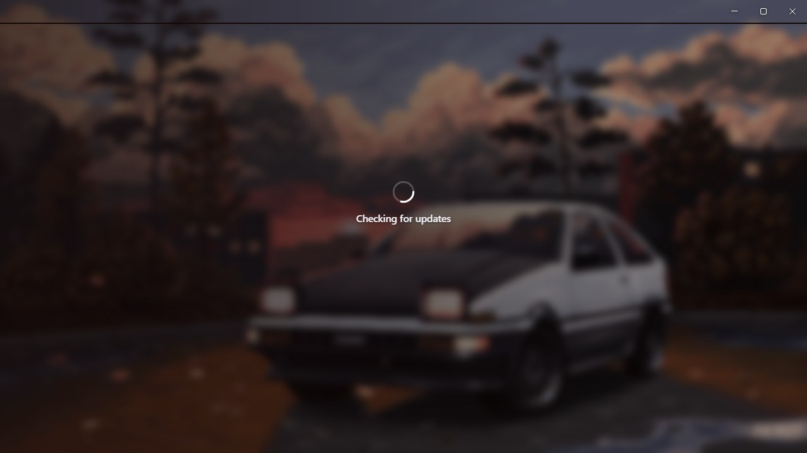

# Pixel art themes for Potassium

Four animated pixel art themes for the Potassium executor. Each one has its own colour palette, its own layout and its own labels, with a looping wallpaper playing behind the whole app.

| Theme | Base theme | Look |
|---|---|---|
| [River Sunset](#river-sunset) | Dark | Night navy and sunset orange, pixel frames, hard drop shadows |
| [Demon Mask](#demon-mask) | Dark | Void black and cursed magenta, pixel frames, glowing heading |
| [Enter the Gungeon](#enter-the-gungeon) | Dark | Breach purple and bullet cyan, pixel frames, meteor-glow accents |
| [Sunset Drive](#sunset-drive) | Dark | Dusk brown and tail-light red, pixel frames, retro racing heading |

Previews are animated (AVIF) and show the Start page, a script tab and the loading screen at full size. Browsers that can't play AVIF show a still screenshot instead.

## Install

1. In Potassium, open **Settings → Appearance → Custom theme**.
2. Set **Base theme** to the one listed for that theme (Dark or **Light**). The editor's syntax colours come from the base theme.
3. Open the theme's folder, copy everything in its `Theme.css` and paste it into **Custom CSS**.
4. Type a name under **Save** and click **Save**.

## Loading screen

Every theme also replaces Potassium's own loading and login picture with its wallpaper, softly blurred, so the theme starts the moment the app opens. Each theme's loading screen is shown under its preview.

## River Sunset

<picture>
  <source srcset="river-sunset/screens.avif" type="image/avif">
  
</picture>

<picture>
  <source srcset="river-sunset/loading.avif" type="image/avif">
  
</picture>

[`Theme.css`](river-sunset/Theme.css) · Base: Dark

## Demon Mask

<picture>
  <source srcset="demon-mask/screens.avif" type="image/avif">
  
</picture>

<picture>
  <source srcset="demon-mask/loading.avif" type="image/avif">
  
</picture>

[`Theme.css`](demon-mask/Theme.css) · Base: Dark

## Enter the Gungeon

<picture>
  <source srcset="gungeon/screens.avif" type="image/avif">
  
</picture>

<picture>
  <source srcset="gungeon/loading.avif" type="image/avif">
  
</picture>

[`Theme.css`](gungeon/Theme.css) · Base: Dark

## Sunset Drive

<picture>
  <source srcset="car-sunset/screens.avif" type="image/avif">
  
</picture>

<picture>
  <source srcset="car-sunset/loading.avif" type="image/avif">
  
</picture>

[`Theme.css`](car-sunset/Theme.css) · Base: Dark

## Notes

- Wallpapers are animated AVIF files loaded from this repo, so you need internet the first time. If a wallpaper can't load, the colours still apply.
- Potassium cuts custom CSS off at 50,000 characters. Each theme is about 6,500, so there's room for your own tweaks.
- The layouts target Potassium's internal class names. A future Potassium update could rename them; if that happens, the colours keep working but some layout touches may not.

## Credits

Each pixel artwork belongs to its original artist. Enter the Gungeon belongs to Dodge Roll and Devolver Digital. The wallpapers are converted from live wallpapers posted on [WallpaperWaifu](https://wallpaperwaifu.com):
[Sunset Over River in the Evening Pixel](https://wallpaperwaifu.com/pixel-art/sunset-over-river-in-the-evening-pixel-live-wallpaper-1501/),
[Demon Mask Pixel](https://wallpaperwaifu.com/pixel-art/demon-mask-pixel-live-wallpaper-1129/),
[Enter the Gungeon Pixel](https://wallpaperwaifu.com/pixel-art/enter-the-gungeon-pixel-live-wallpaper-1240/),
[Car in Sunset](https://wallpaperwaifu.com/pixel-art/car-in-sunset-live-wallpaper-707/).
